# 🍔 The Burger House

**O artesanal tem outro sabor.**

Plataforma **full-stack de pedidos e gestão operacional para hamburgueria**, desenvolvida com **React 19, TypeScript, Vite 8, Tailwind CSS v4, ASP.NET Core 9, Entity Framework Core e PostgreSQL 18**, reunindo vitrine digital, cardápio interativo com informações nutricionais, sacola persistente com sincronização entre abas, checkout integrado ao **PagBank Hosted Checkout (Sandbox)**, webhooks assinados em ECDSA, reconciliação financeira, painel administrativo **Owner React** completo e controles de privacidade e criptografia AES-256-GCM.

> **Status operacional:** a arquitetura 2.0 foi publicada na release [`v5.0.0`](https://github.com/felipe-frc/the-burger-house/releases/tag/v5.0.0), com API ASP.NET Core e PostgreSQL 18 implantados no Azure e vitrine React + painel Owner publicados na Vercel em ambiente demonstrativo com PagBank Sandbox. A liberação comercial para recebimento de pagamentos reais constitui uma etapa independente.

📂 [Repositório](https://github.com/felipe-frc/the-burger-house) • 🧪 [GitHub Actions](https://github.com/felipe-frc/the-burger-house/actions) • 📦 [Releases anteriores](https://github.com/felipe-frc/the-burger-house/releases)

[](https://github.com/felipe-frc/the-burger-house/actions)


---

## 📌 Sobre o projeto

O **The Burger House** simula uma operação completa de hamburgueria artesanal — da escolha do pedido na vitrine pública até a gestão em cozinha, expedição, entrega e conciliação financeira no painel administrativo.

Originalmente concebido como uma aplicação front-end em JavaScript Vanilla (releases `v1.0.0` a `v4.0.0`), o projeto evoluiu nesta reformulação para uma **plataforma desacoplada em três frentes integradas**:

1. **Vitrine Pública (`frontend/`)**: interface React/TypeScript com identidade visual *American Diner* contemporânea, catálogo dinâmico sincronizado com a API, detalhes nutricionais, sacola inteligente, consulta de CEP via ViaCEP, mapa interativo com consentimento prévio (MapLibre GL), tradução PT/EN e retorno de pagamento.
2. **Painel Owner (`owner-ui/`)**: aplicação React dedicada em `/admin/`, com autenticação por cookie seguro, proteção CSRF e 12 módulos para operação diária, controle de estoque, clientes, equipe, finanças e auditoria.
3. **API & Persistência (`backend/`)**: backend em **ASP.NET Core 9** estruturado em Domain, Application, Infrastructure e API, persistência principal em **PostgreSQL 18** via EF Core / Npgsql (com isolamento SQLite para suítes automatizadas), regras financeiras server-side, criptografia **AES-256-GCM** para dados pessoais e integração ao **PagBank Hosted Checkout**.

Todo o catálogo, valores de demonstração, contas administrativas sintéticas e cobranças em Sandbox possuem caráter exclusivamente demonstrativo: o estabelecimento é fictício e nenhuma venda real é processada.

### 🎯 O que este projeto demonstra

| Competência | Aplicação prática no projeto |
| :--- | :--- |
| **React & TypeScript** | Duas aplicações React 19 independentes (`frontend/` e `owner-ui/`), estado tipado e compartilhamento de domínio em `shared/storefront/` |
| **ASP.NET Core 9 & C#** | API REST modular, injeção de dependência, filtros de acesso, middlewares de segurança, rate limiting e workers em segundo plano |
| **Arquitetura em Camadas** | Separação clara entre `Domain`, `Application`, `Infrastructure` e `Api` |
| **Persistência & PostgreSQL 18** | EF Core + Npgsql, migrations versionadas, verificação estrutural de schema (`VerifyOperationalSchema`) e constraints no banco |
| **Pagamentos & Webhooks** | Checkout hospedado PagBank Sandbox, validação de assinatura **ECDSA/SHA-256**, idempotência e reconciliação de status |
| **Segurança & LGPD** | Prova criptográfica `X-Order-Access`, AES-256-GCM por campo com AAD, cookie `HttpOnly/SameSite=Strict`, CSRF e minimização de dados |
| **Acessibilidade & Responsividade** | Auditorias com `axe-core`, navegação por teclado, `prefers-reduced-motion` e validação visual de `320px` a `1920px` |
| **Engenharia de Qualidade** | Suítes independentes com xUnit (.NET), Vitest, Node Test Runner, Playwright (desktop, mobile e Owner E2E) e Gitleaks |
| **Automação & CI/CD** | Workflows em GitHub Actions, empacotamento Vercel Build Output API e ambiente local HTTPS reproduzível |

---

## ⭐ Destaques técnicos

- **Arquitetura em camadas** no backend (.NET 9) com validação server-side de produtos, adicionais, cupons, limites de itens/quantidades e totais antes da criação do pagamento
- **Persistência principal em PostgreSQL 18** via EF Core + Npgsql, com migrations verificadas no startup e suporte a testes isolados em SQLite temporário ou laboratório PostgreSQL descartável (`tbh_migration_lab`)
- **PagBank Hosted Checkout (Sandbox)** sem tráfego de dados de cartão na aplicação: o navegador redireciona apenas para URLs HTTPS autorizadas e toda confirmação depende do estado verificado no servidor
- **Webhooks ECDSA/SHA-256** validados sobre os bytes originais do payload (limite de `256 KiB`) com cache de chave pública e conciliação ativa contra a API PagBank
- **Idempotência e recuperação segura**: retomada de checkout pendente por até 24 horas sem duplicar pedidos nem confirmar pagamentos não aprovados
- **Proteção de acesso a pedidos (`X-Order-Access`)**: token assinado via ASP.NET Data Protection emitido na criação do pedido; o comprovante mínimo pós-aprovação permanece restrito à aba em `sessionStorage` e não reabre automaticamente após recarga ou nova sessão
- **Criptografia de PII em repouso** com **AES-256-GCM** (`enc:v1` com AAD por campo), evitando exposição de CPF, e-mail, telefone ou endereço em logs de auditoria
- **Painel Owner separado** com sessão autenticada revogável por hash SHA-256 em banco, proteção timing-safe no login, cabeçalhos anti-CSRF e controle de concorrência otimista nas edições
- **Internacionalização PT/EN** com tradução de interface e produtos, preservação da preferência no navegador e fallback seguro
- **Acessibilidade e responsividade**: auditorias automatizadas (`axe-core` + Playwright), foco gerenciado em modais/drawers, atalhos de teclado e suporte validado de `320×568` a `1920×1080`
- **Hardening HTTP**: cabeçalhos globais (`X-Content-Type-Options: nosniff`, `X-Frame-Options: DENY`, `Referrer-Policy: no-referrer`, `Content-Security-Policy` restritiva na API, `HSTS` fora de Development) e re-encoding de uploads de imagem com `SkiaSharp` (remoção de EXIF)

> *Os controles implementados reduzem riscos comuns de aplicações web e de pagamento em ambiente de portfólio, mas não substituem auditorias de produção, infraestrutura gerenciada ou validação jurídica antes de operação comercial real.*

---

## 🚀 Funcionalidades

| Área | Recursos implementados |
| :--- | :--- |
| 🍔 **Vitrine & Cardápio** | 3 categorias (*Burgers*, *Acompanhamentos*, *Bebidas*), modal de detalhes com abas de *Ingredientes* e *Informações Nutricionais*, status de disponibilidade e tradução PT/EN |
| 🛒 **Sacola & Sessão** | Adição/remoção, adicionais configuráveis, observações limitadas, cupom cotado no servidor, expiração por inatividade (30 min) e sincronização entre abas da mesma compra |
| 🚚 **Entrega / Retirada** | Fluxo independente para retirada no local (frete zerado) ou entrega com busca automática de CEP via **ViaCEP** e validação de endereço |
| 📍 **Localização & Fidelidade** | Mapa interativo com **MapLibre GL** condicionado ao consentimento de privacidade e cartão fidelidade demonstrativo |
| 💳 **Pagamentos** | Criação do pedido + checkout hospedado PagBank Sandbox, retorno seguro, consulta autenticada de status, webhook ECDSA e reconciliação de pendentes |
| 🧑‍💼 **Painel Owner** | 12 módulos integrados de operação e gestão, busca global (`Ctrl + K`), central de notificações em caixa persistida, agenda e histórico de auditoria |
| 🔐 **Privacidade & Dados** | Central `/rights.html` (canal de solicitações de titulares opcional), gestão de consentimento versionado, `X-Order-Access` e AES-256-GCM |

### 🍔 Vitrine

- **Cardápio completo e detalhado**: exibe os produtos ativos sincronizados com `/api/products`, preços formatados em BRL/EN, imagens WebP responsivas (`-384.webp` / `-768.webp`), modal de detalhes com tabela nutricional por porção e suporte a adicionais (`extras`).
- **Sacola inteligente**: identificada por compra (`cartStorage.ts`), com retenção de 30 minutos para compras ativas, extensão automática para 24 horas quando há checkout pendente, sincronização entre abas compartilhadas e limpeza idempotente apenas dos itens já confirmados como pagos.
- **Entrega ou retirada**: recalcula totais no backend via `/api/orders/quote` e `/api/orders`, preenche logradouro/bairro/cidade pela API ViaCEP na entrega e dispensa endereço na retirada no local.
- **Localização e fidelidade**: carrega o mapa sob demanda mediante consentimento explícito do visitante (revogável a qualquer momento) e apresenta o modal interativo do programa de fidelidade demonstrativo.

### 💳 Pagamentos

- **Fluxo hospedado**: o backend persiste o pedido e cria ou reutiliza a tentativa local de pagamento antes de solicitar a sessão de checkout ao PagBank (`CreateHostedCheckoutHandler`), mantendo dados de cartão fora da aplicação.
- **Confirmação confiável**: parâmetros de retorno na URL nunca comprovam pagamento; tanto a vitrine quanto o retorno consultam `GET /api/payments/{id}` (protegido por `X-Order-Access`), enquanto webhooks assinados com ECDSA/SHA-256 e rotinas de reconciliação atualizam o estado canônico em banco.
- **Privacidade pós-pagamento**: após a confirmação aprovada, o comprovante mínimo (`burger-house-last-receipt-v2` com versão, ID do pedido e token de acesso) fica restrito à aba atual em `sessionStorage`, expurga registros legados de `localStorage` e nunca reabre automaticamente ao recarregar a página ou iniciar nova sessão. Pagamentos ainda pendentes permanecem retomáveis por até 24 horas.

### 🧑‍💼 Painel Owner

Organizado em `/admin/` com navegação por barra lateral responsiva (`owner-ui/src/components/layout/Sidebar.tsx`), dividido em **Operação**, **Gestão** e **Configurações**, além de utilitários globais no topo (`Navbar`):

- **Operação:**
  - **Visão Geral (`overview`)**: saudação contextual em fuso `America/Sao_Paulo`, indicadores do dia (receita bruta, pedidos pagos, ticket médio, aguardando pagamento, atrasados/tempo médio na cozinha), pipeline em 5 etapas, pedidos ativos, evolução de vendas e gráfico de participação por categoria.
  - **Pedidos (`orders`)**: filtros por canal (*Todos*, *Delivery*, *Balcão*), status e busca paginada no servidor, além do modal detalhado do pedido.
  - **Cozinha (`kitchen`)**: fila operacional de recebidos e preparo em chapa com acompanhamento de limites de atraso.
  - **Expedição (`expedition`)**: checklist obrigatório de conferência item a item antes do despacho com registro em auditoria.
  - **Entregas (`delivery`)**: gestão de pedidos em rota, vínculo de responsável e finalização com atualização persistida e mapa de rastreamento operacional (`DeliveryTrackingModal`).
- **Gestão:**
  - **Cardápio (`menu`)**: cadastro e edição de produtos, categoria, ordem de exibição, disponibilidade, tradução para inglês e upload/remoção de imagens processadas no servidor.
  - **Estoque (`stock`)**: saldo de insumos, alerta automático de estoque mínimo, movimentações fracionárias e histórico por item.
  - **Clientes (`customers`)**: visão agregada derivada exclusivamente de compras aprovadas, com proteção aos dados pessoais armazenados.
  - **Financeiro (`financial`)**: resumo financeiro por período, estornos, lucro bruto sobre pedidos com custo, meios de pagamento, transações, conciliação produto × pagamento, exportação CSV e auditoria financeira.
  - **Relatórios (`reports`)**: consolidação de receita bruta por período, exportação CSV e mapa semanal/mensal de movimento por dia e faixa horária.
  - **Equipe (`team`)**: cadastro, edição, ativação/desativação, filtros de equipe e registros operacionais (ponto/jornada e histórico).
- **Configurações e ferramentas transversais:**
  - **Configurações (`settings`)**: limites operacionais de tempo por etapa (cozinha, conferência e entrega), revisão concorrente, troca de senha administrativa e fila de solicitações de privacidade (quando habilitada).
  - **Utilitários globais**: **Busca Global** (`Ctrl + K`), **Agenda administrativa** (`AgendaModal`), **Central de Notificações** (`NotificationDrawer` com arquivamento e desfazer) e **Trilha de Auditoria** (`AuditTrailModal`).

### 🔐 Privacidade e segurança

- Consentimento granular em navegador com validade técnica de 180 dias, desativando mapa e analytics opcionais por padrão (`GA4` permanece desligado sem configuração explícita, consentimento e ausência de DNT/GPC).
- Prova de acesso por pedido (`X-Order-Access`) gerada via ASP.NET Data Protection separada da autenticação Owner.
- Criptografia **AES-256-GCM** para dados pessoais sensíveis na base de dados.
- Canal de direitos dos titulares (`/rights.html`) e revisão administrativa em *Configurações* como módulo opcional desligado por padrão (`Privacy:RequestsEnabled`).

---

## 📸 Interface

Todas as capturas abaixo foram geradas com **dados 100% sintéticos e builds reais** das aplicações React atuais.

### 🏠 Vitrine — Página inicial (Desktop e Mobile)

Hero principal *American Diner*, barra de navegação fixa, troca de idioma PT/EN, acesso ao cardápio e sacola responsiva.

| Desktop (`1440×900`) | Mobile (`390×844`) |
| :---: | :---: |
| 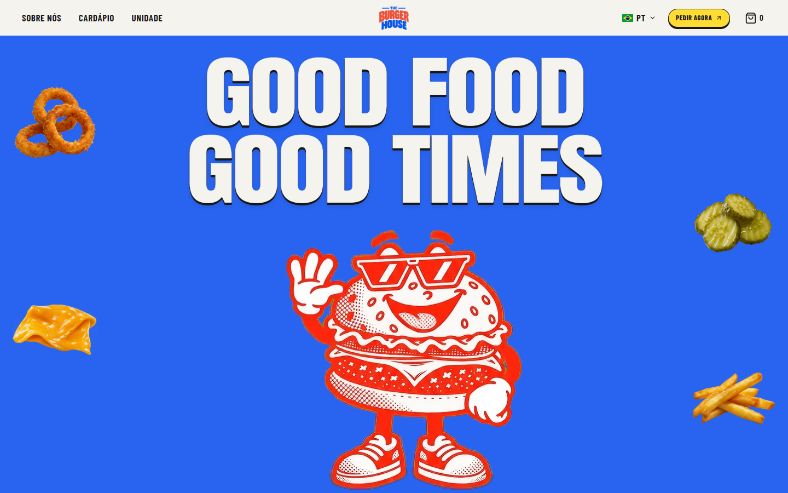 | 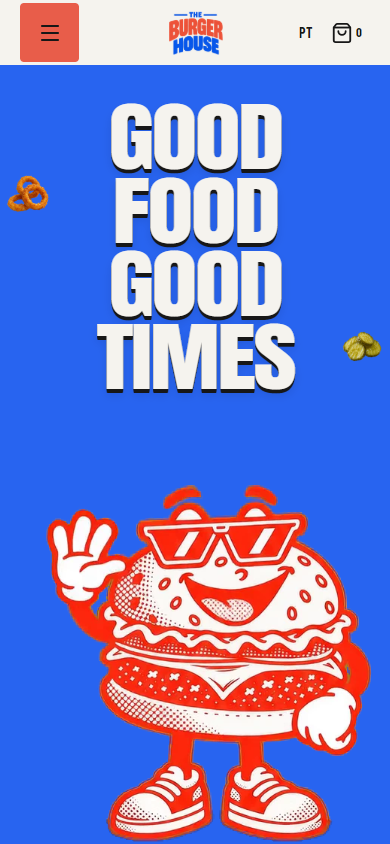 |

### 🍔 Vitrine — Cardápio completo (Desktop e Mobile)

Modal do cardápio dividido em *Smash Burgers*, *Acompanhamentos* e *Bebidas*, com fotos otimizadas em WebP, preços sincronizados e barra inferior da sacola.

| Desktop (`1440×900`) | Mobile (`390×844`) |
| :---: | :---: |
| 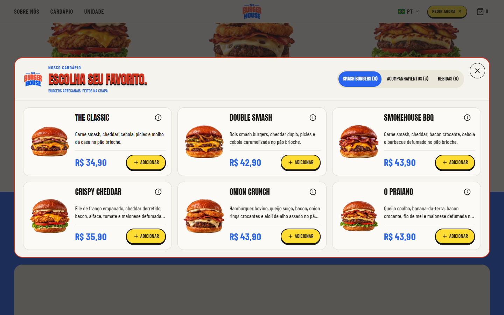 | 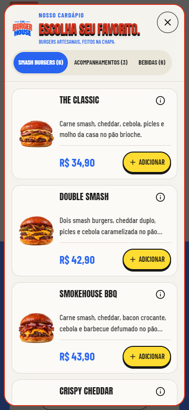 |

### 🧾 Detalhes do produto, Ingredientes e Nutrição

Visualização detalhada do produto com alternância acessível por teclado entre descrição/ingredientes e tabela de informações nutricionais.

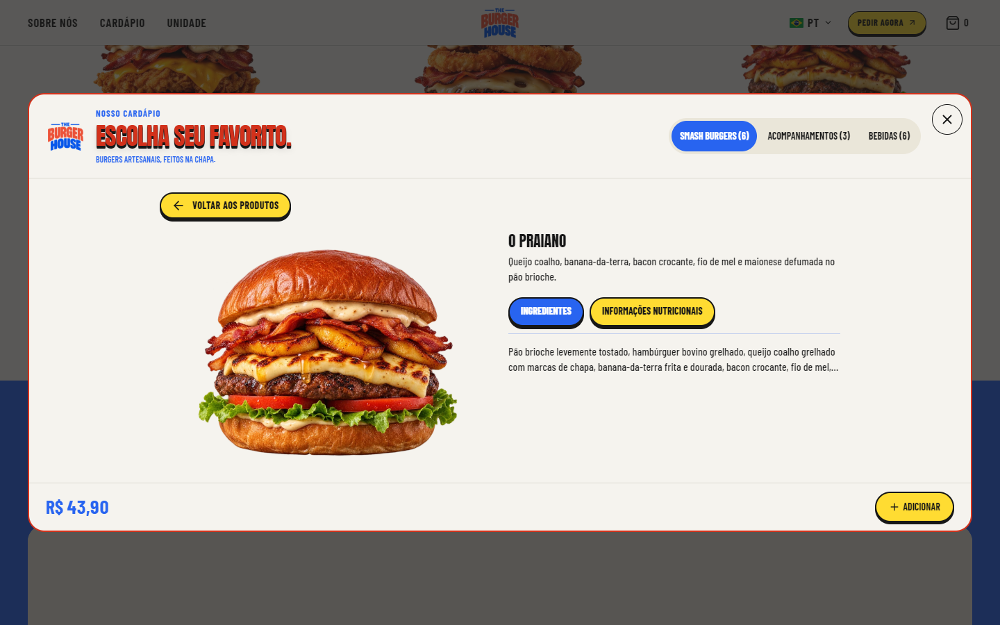

### 🛒 Sacola e Fluxo de Entrega / Retirada

Drawer *Seu Pedido* em 3 etapas (*Sacola*, *Identificação*, *Revisão*) com ajuste de quantidades, adicionais, observações e alternância entre retirada gratuita e entrega com CEP.

| Etapa 1 — Sua sacola | Etapa 2 — Identificação e Entrega (placeholders) |
| :---: | :---: |
| 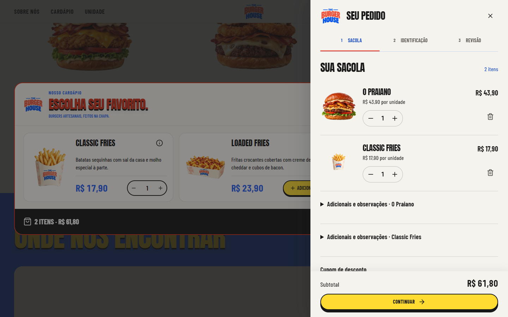 | 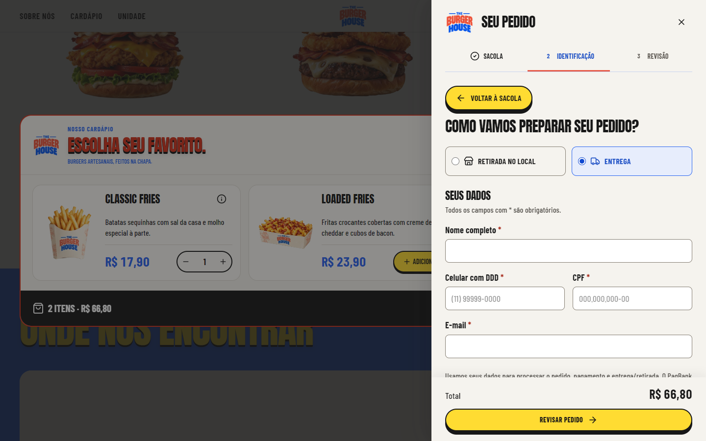 |

### ✅ Confirmação de pagamento demonstrativa

Tela *Seu Pagamento* exibindo pedido aprovado pelo servidor em modo demonstrativo, sem exposição de dados pessoais nem reabertura automática em sessões futuras.

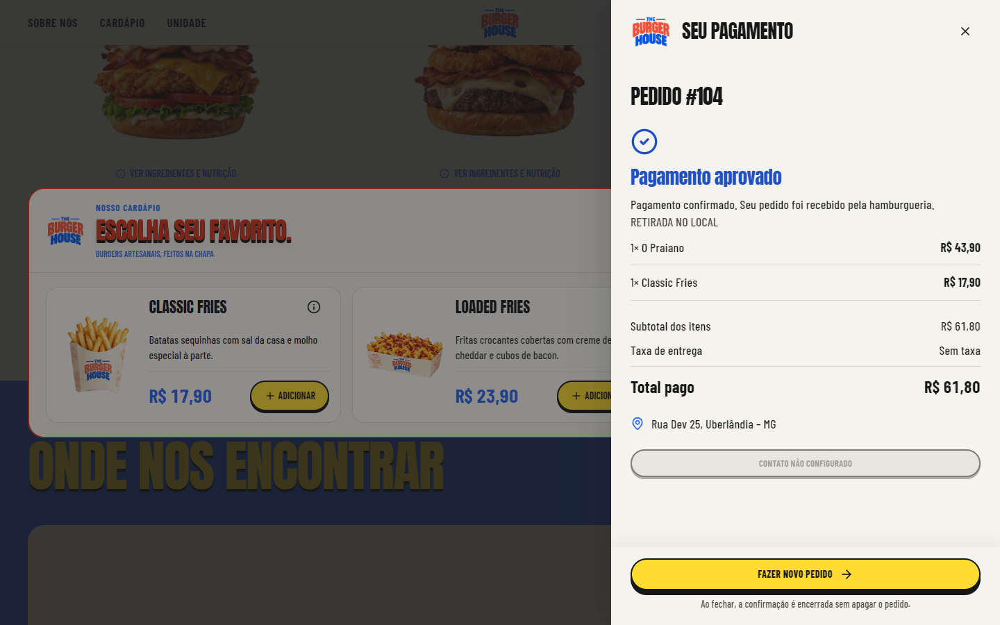

### 🧑‍💼 Painel Owner — Visão Geral (Tema Claro e Tema Escuro)

Indicadores em tempo real, pipeline operacional em 5 etapas, pedidos ativos, evolução de vendas e gráfico de participação por categoria com acessibilidade verificada.

| Tema Claro | Tema Escuro |
| :---: | :---: |
| 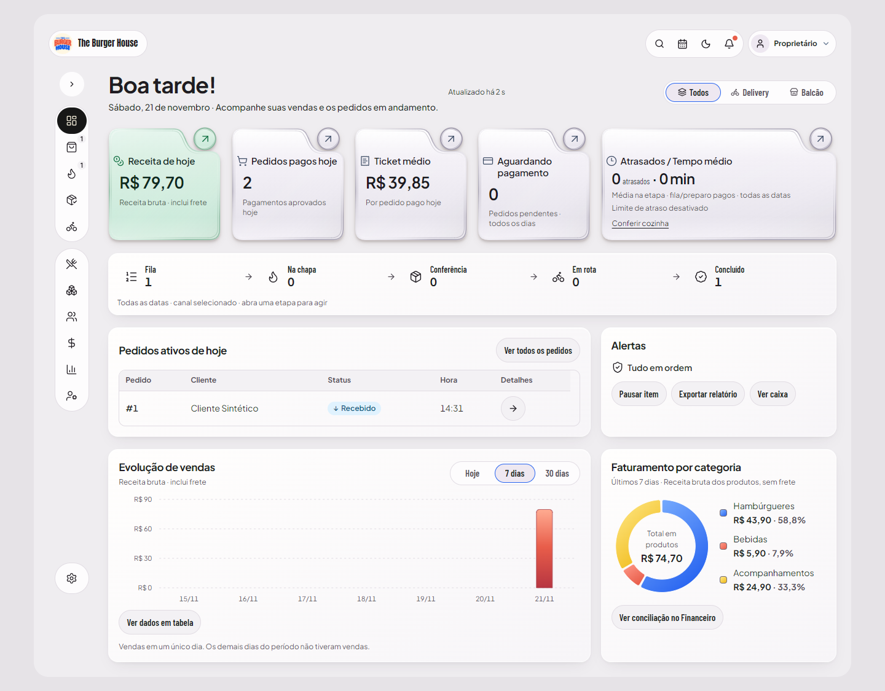 | 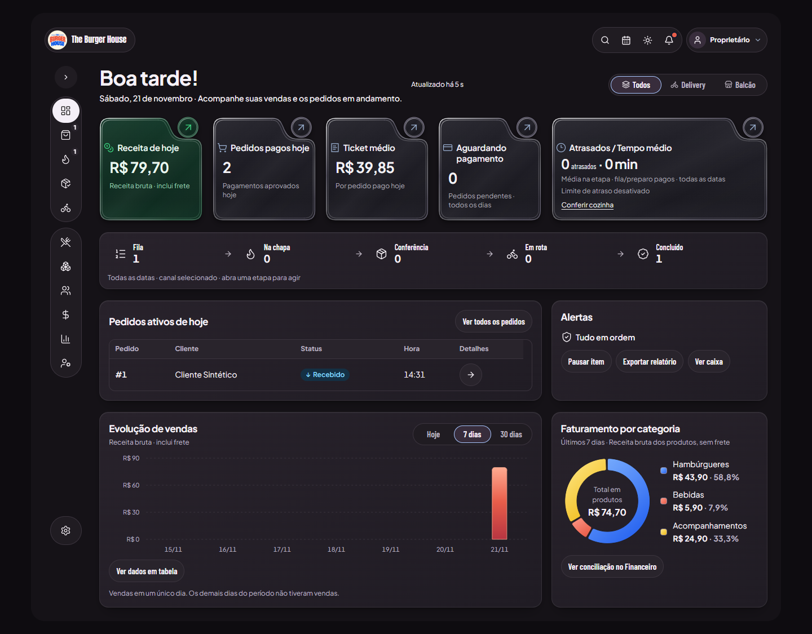 |

### 📦 Painel Owner — Operação de Pedidos e Financeiro

Gestão operacional da fila de pedidos (busca, filtros por canal/status e transições controladas) e painel financeiro com receita líquida, estornos, meios de pagamento e conciliação.

| Pedidos operacionais | Visão Financeira e Conciliação |
| :---: | :---: |
| 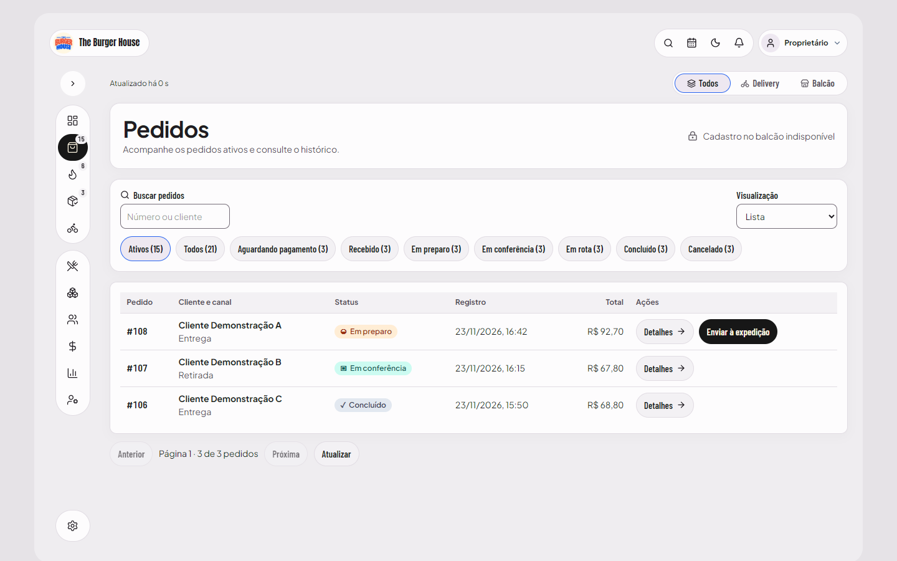 | 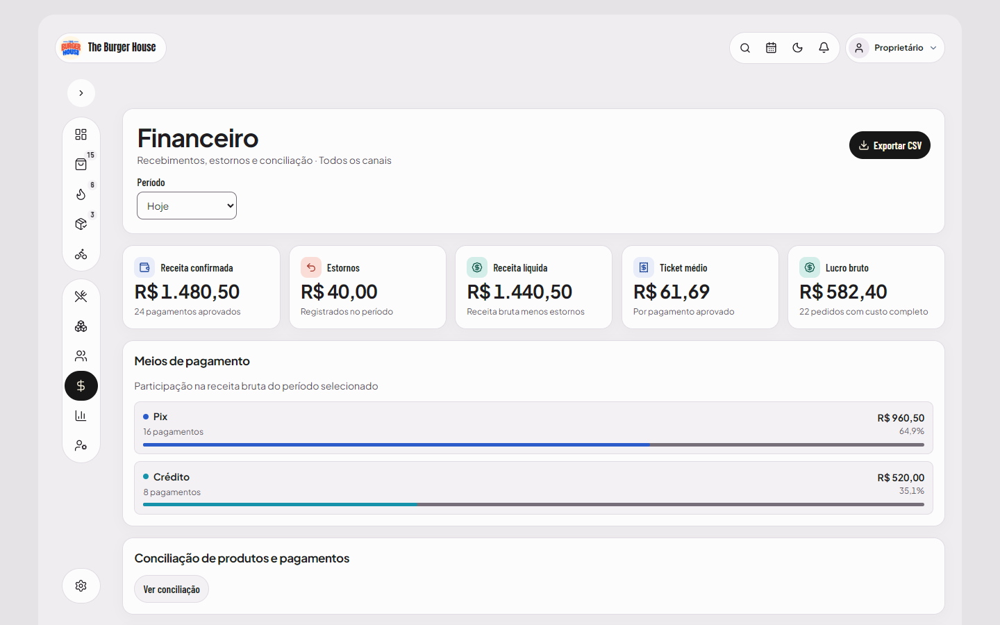 |

---

## 🛠️ Tecnologias

| Camada / Área | Tecnologia | Aplicação real no repositório |
| :--- | :--- | :--- |
| **Vitrine Web** | React 19 + TypeScript + Tailwind CSS v4 + GSAP 3 | `frontend/` — UI, animações, modais acessíveis e checkout |
| **Painel Owner** | React 19 + TypeScript + Recharts 3 + Lucide React | `owner-ui/` — 12 módulos administrativos em `/admin/` |
| **Mapas & Geolocalização** | MapLibre GL 6 (`maplibre-gl`) + MapTiler | Mapa da unidade e rastreio de entrega (com consentimento na vitrine) |
| **Empacotamento Web** | Vite 8 + Vercel Build Output API (`scripts/package-official-frontend.mjs`) | Build isolado com CSP estrita e separação entre `/` e `/admin/` |
| **Backend** | ASP.NET Core 9 (C#) | `backend/BurgerHouse.Api` — API REST, Auth/CSRF, Rate Limiting, Middlewares |
| **Domínio & Casos de Uso** | .NET 9 Class Libraries | `BurgerHouse.Domain` e `BurgerHouse.Application` |
| **ORM & Banco Principal** | Entity Framework Core 9 + Npgsql (`PostgreSQL 18.1`) | `PostgresContext` — persistência principal com verificação de schema |
| **Banco de Testes** | EF Core SQLite 9 | Suítes automatizadas isoladas sem tocar no banco principal |
| **Mídia Backend** | SkiaSharp 4 | Validação e re-encoding de imagens de catálogo em WebP sem EXIF |
| **Pagamentos** | PagBank Hosted Checkout + Webhook ECDSA | `PagBankWebhookSignatureValidator`, reconciliação e idempotência |
| **Consultas Externas** | ViaCEP API | Autocompletar endereço brasileiro por CEP na entrega |
| **Qualidade & E2E** | xUnit, Vitest 4, Node Test Runner, Playwright, `@axe-core/playwright` | Cobertura por camada, E2E desktop/mobile/Owner e acessibilidade |
| **Segurança & CI** | Gitleaks + GitHub Actions (`ubuntu-latest`, Node 24, .NET 9) | Varredura de segredos e pipelines em `.github/workflows/` |

---

## 🏗️ Arquitetura

A arquitetura separa claramente o domínio compartilhado da vitrine, o painel administrativo Owner, a API ASP.NET Core em camadas e as integrações externas:

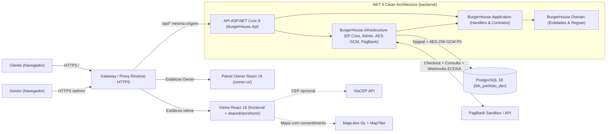

### Camadas do Backend (`backend/`)

| Projeto | Responsabilidade |
| :--- | :--- |
| `BurgerHouse.Domain` | Entidades (`Order`, `OrderItem`, `Payment`, `Product`, `StockItem`, `TeamMember`, etc.), enums e invariantes de domínio |
| `BurgerHouse.Application` | Casos de uso, DTOs, validações de pedidos/pagamentos e abstrações (`IOrderRepository`, `IPaymentRepository`, `IHostedCheckoutGateway`, etc.) |
| `BurgerHouse.Infrastructure` | `PostgresContext` e `BurgerHouseDbContext`, migrations EF Core, criptografia AES-256-GCM (`AesGcmPersonalDataProtector`), serviços administrativos e cliente/validador PagBank |
| `BurgerHouse.Api` | Controllers públicos e administrativos (`/api/orders`, `/api/checkout`, `/api/payments`, `/api/webhooks/pagbank`, `/api/admin/*`, `/api/privacy/*`), cookie auth, CSRF, rate limiting, `AdminErrorsMiddleware` e headers globais de segurança |
| `*.Tests` & `tools/` | 4 projetos de teste (`Domain.Tests`, `Application.Tests`, `Infrastructure.Tests`, `Api.Tests`) + `HomologationFixture` e `OwnerRecoveryHost` |

### 📁 Estrutura do repositório

```txt
the-burger-house/
├── .github/workflows/
│   ├── frontend-ci.yml                  # CI da vitrine oficial (typecheck, Vitest, unit, build)
│   ├── backend-deploy.yml               # CI do backend (.NET restore, build, test, artifact)
│   └── backend-deploy-manual.yml        # Deploy manual opt-in em Azure (somente branch main)
├── backend/
│   ├── BurgerHouse.Domain/
│   ├── BurgerHouse.Application/
│   ├── BurgerHouse.Infrastructure/      # EF Core, Npgsql, AES-GCM, PagBank, Migrations
│   ├── BurgerHouse.Api/                 # API REST, Auth Owner, Webhooks, Privacy
│   ├── BurgerHouse.*.Tests/             # Suítes xUnit por camada
│   ├── tools/                           # HomologationFixture e OwnerRecoveryHost
│   └── BurgerHouse.sln
├── frontend/                            # Vitrine React 19 + TypeScript + Vite 8 + Tailwind v4
├── owner-ui/                            # Painel Administrativo Owner React (/admin/)
├── shared/storefront/                   # Fonte única de catálogo, contratos e cliente HTTP
├── src/                                 # Shims de compatibilidade para a suíte Vitest da raiz
├── scripts/
│   ├── admin/                           # Launcher local (portfolio-local.ps1), HTTPS local e utilitários PostgreSQL
│   ├── package-official-frontend.mjs    # Empacotador Vercel Build Output API com CSP
│   └── check-publication.py             # Gate de índice e histórico Git pré-publicação
├── tests/
│   ├── integration/                     # E2E Playwright da vitrine (desktop + mobile)
│   ├── e2e/                             # E2E Playwright estrutural e contratual do Owner
│   └── *.test.{js,mjs}                  # Políticas estáticas e contratos legados
├── docs/                                # Guias HTTPS, PostgreSQL, PagBank, privacidade e capturas
├── .env.example                         # Variáveis-exemplo na raiz (+ frontend/.env.example e owner-ui/.env.example)
├── .gitleaks.toml                       # Configuração de varredura de segredos
├── publication-policy.json              # Política de caminhos privados bloqueados para publicação
├── vercel.json                          # Build Vercel com git.deploymentEnabled=false
└── README.md
```

---

## ✅ Qualidade e testes

### 📊 Última medição consolidada (23/11/2026)

Os números abaixo foram executados após todas as correções locais da versão candidata, reportados individualmente por suíte (sem somar suítes que compartilham casos):

| Suíte | Comando verificado | Aprovados | Reprovados | Ignorados | Escopo e observações |
| :--- | :--- | ---: | ---: | ---: | :--- |
| **Backend .NET 9 (Release)** | `dotnet test backend/BurgerHouse.sln --no-restore -c Release` | **743** | **0** | **1** | Domain `142`, Application `49`, Infrastructure `310`, Api `242`. O único skip (`ExternalSandboxCheckoutTests`) exige credencial externa opt-in (`TBH_EXTERNAL_SANDBOX=1`). |
| **Owner E2E (Playwright)** | `npm run test:owner:e2e` | **104** | **0** | **0** | Cobre login/CSRF, KPIs, todos os 12 módulos, fluxos de cozinha/expedição/entregas, financeiro/conciliação, gráficos e temas claro/escuro com API simulada. |
| **Integração Desktop (Playwright)** | `npx playwright test --config playwright.integration.config.ts --project=desktop` | **59** | **0** | **0** | Cobre fluxo completo de catálogo, checkout, PagBank controlado, sessão de comprovante, privacidade, CSP e imagens em múltiplas larguras. |
| **Integração Mobile (Playwright)** | `npx playwright test --config playwright.integration.config.ts --project=mobile` | **41** | **0** | **18** | Emulação Pixel 5. Os 18 ignorados são `test.skip` explícitos para casos marcados como desktop-only (matriz desktop de `frontend-audit`, `privacy` e screenshot). |
| **Unitários Owner** | `npm --prefix owner-ui test` | **72** | **0** | **0** | Serviços Owner, CSRF, conciliação financeira, agregação de movimento e SLAs operacionais. |
| **Unitários Vitrine** | `npm run test:frontend` | **30** | **0** | **0** | Sessão/expiração de sacola, catálogo, nutrição, mapa, privacidade e consentimento. |
| **Vitest Raiz** | `npm test` | **42** | **0** | **0** | Contratos `shared/storefront`, validações CPF/telefone/CEP, cliente HTTP e registro administrativo em loopback. |
| **Admin / Contratos Legados** | `npm run test:admin` | **154** | **0** | **0** | Executa `owner-ui` (`72`) + suíte legada Vitest (`82`: classificação, status e checkout). *(Sobrepõe os 72 unitários do Owner.)* |
| **Políticas Estáticas & CI** | `node --test tests/publication-policy.test.mjs tests/homologation-static.test.mjs tests/portfolio-checkout-policy.test.mjs` | **10** | **0** | **0** | Verifica roteamento estático, política de checkout persistente, `publication-policy.json`, workflows e `vercel.json`. |
| **Typecheck & Builds** | `npm run typecheck`, `npm --prefix owner-ui run lint`, `npm run build`, `npm --prefix owner-ui run build` | **4/4** | **0** | **0** | Compilação limpa sem erros TypeScript nem warnings bloqueantes de bundle. |

### 📱 Auditoria de responsividade (320 px a 1920 px)

A vitrine construída (`frontend/dist`) foi validada em navegador real (Chrome via Playwright) em **12 resoluções** (`320×568`, `360×640`, `375×667`, `390×844`, `414×896`, `430×932`, `768×1024`, `820×1180`, `1024×768`, `1280×800`, `1440×900` e `1920×1080`), além da matriz estrutural do Owner React, confirmando **0 pixels de overflow horizontal**, zero imagens quebradas e botões acessíveis sem truncamento.

### ☁️ Validação operacional pós-v5.0.0

Após a publicação da `v5.0.0`, foram concluídas a implantação e a estabilização operacional da aplicação publicada:

- **PostgreSQL em produção (Azure):** migração de dados SQLite → PostgreSQL 18 efetivamente implantada e reconciliada com preservação de registros históricos, integridade referencial/financeira verificada, recuperação operacional de autenticação e conexão obrigatória com `SSL Mode=VerifyFull`.
- **Aplicação publicada (Azure + Vercel):** API em Azure App Service (`GET /health/ready` → `204`) integrada à vitrine React e ao painel Owner publicados na Vercel, com CORS restrito à origem HTTPS publicada, redirecionamento de retorno PagBank ajustado e bypass de webhooks Sandbox sem assinatura desativado.
- **Homologação do painel Owner publicado:** todos os módulos administrativos publicados foram inspecionados em modo estritamente somente leitura, sem erros de API ou runtime.
- **PagBank Sandbox externo (PostgreSQL isolado):** execução controlada de `ExternalSandboxCheckoutTests` contra o PagBank Sandbox real em banco PostgreSQL isolado validou criação de checkout hospedado, persistência e reutilização idempotente, sem tocar no banco de produção e sem executar pagamento financeiro real.
- **Correções pós-publicação:** ajuste do verificador de deploy hospedado (`scripts/verify-hosted-preview.mjs` + testes em `tests/hosted-preflight.test.js`) para o bundle Vite com `font-guard.js`, e correção do contorno visual de foco indesejado em `main.owner-main` (`owner-ui/src/index.css`) preservando foco programático, navegação por teclado e modos claro e escuro.

### Limitações conhecidas de validação e atividades futuras

- **Pagamentos e webhooks:** nenhum pagamento financeiro real foi executado e nenhum callback externo real de pagamento foi comprovado no teste externo de Sandbox; a validação criptográfica de webhooks assinados em ECDSA permanece coberta pelos testes automatizados internos, e a liberação comercial para recebimento de pagamentos reais constitui uma etapa independente.
- **Ciclo de vida do runtime:** o **.NET 9** encontra-se fora de suporte; a atualização para **.NET 10 LTS** permanece planejada como intervenção futura independente.
- **Teste físico Android:** validações visuais e de fluxo em smartphone físico via ADB não foram executadas por ausência de aparelho conectado durante a bateria (procedimento completo documentado na seção **Como Executar**).

---

## 🔐 Segurança

### Controles comprovados no código

- **Variáveis de ambiente e segredos**: arquivos `.env*` locais, certificados (`.key`, `.pem`, `.pfx`, `.dpapi`) e perfis locais ficam excluídos no `.gitignore`. Os arquivos [`.env.example`](.env.example), [`frontend/.env.example`](frontend/.env.example) e [`owner-ui/.env.example`](owner-ui/.env.example) contêm exclusivamente placeholders.
- **PagBank Sandbox**: credenciais do provedor ficam apenas no processo do servidor (via `dotnet user-secrets` no Windows ou variáveis de ambiente privadas em servidor) e jamais são expostas em variáveis `VITE_*`. Apenas URLs HTTPS em `pagamento.pagbank.com.br` e `pagamento.sandbox.pagbank.com.br` são aceitas no redirecionamento.
- **Controle de acesso ao pedido público**: criação do pedido retorna `orderAccessToken` (ASP.NET Data Protection), exigido no cabeçalho `X-Order-Access` para iniciar checkout ou consultar status de pagamento — números de pedido, CPF ou e-mail isolados não autorizam consulta.
- **Proteção de dados pessoais em repouso**: campos pessoais sensíveis utilizam criptografia autenticada **AES-256-GCM** por campo com AAD (`Privacy__EncryptionKey` de 32 bytes em Base64).
- **Segurança administrativa (Owner)**: cookie `BurgerHouse.Owner` restrito a `/api/admin` (`HttpOnly`, `SameSite=Strict`, `Secure=Always` fora de Development), sessões administrativas persistidas com hash SHA-256 revogáveis no servidor e proteção CSRF obrigatória (`[AutoValidateAntiforgeryToken]`).
- **Headers de resposta na API**: `X-Content-Type-Options: nosniff`, `X-Frame-Options: DENY`, `Referrer-Policy: no-referrer`, `Content-Security-Policy: default-src 'none'; frame-ancestors 'none'` e `HSTS` fora de Development.
- **Varreduras realizadas**: `gitleaks` reportou **0 vazamentos** na área staged, nos **206 commits** do histórico analisado e nos diretórios candidatos do workspace; as auditorias `npm audit --omit=dev` (raiz, `frontend` e `owner-ui`) e NuGet transitivo em 8 projetos .NET registraram **0 vulnerabilidades conhecidas** na linha de base auditada.

> **Importante — Requisitos pendentes para implantação em produção real:** esta base local **não** está pronta para operar transações financeiras reais sem configuração externa adicional. Antes de qualquer deploy público:
> 1. Habilitar `ForwardedHeaders_Enabled=true` com proxies/redes confiáveis (`Admin:ForwardedHeaders`) para que o rate limiting público identifique corretamente o IP de origem atrás de proxy reverso;
> 2. Configurar proteção em repouso do key ring ASP.NET Data Protection em ambiente Linux (ex.: Azure Key Vault + armazenamento persistente), pois `ProtectKeysWithDpapi()` só atua no Windows;
> 3. Restringir `AllowedHosts` e `Cors:AllowedOrigins` aos domínios HTTPS definitivos;
> 4. Fornecer `ConnectionStrings__DefaultConnection` com `SslMode=VerifyFull`, `Privacy__EncryptionKey` estável e credenciais PagBank de produção em secret store;
> 5. Revisar `connect-src` na CSP e a necessidade ou proxy do widget de clima (`OverviewGreeting.tsx`).

---

## ♿ Acessibilidade

- Marcações semânticas (`main`, `nav`, `region`, `dialog`, `aria-live`, `role="alert"`, `aria-modal`, associação `aria-describedby` e `aria-labelledby`).
- *Focus trap* e restauração de foco ao abrir/fechar modais de cardápio, drawer de checkout, detalhes de produto e modais administrativos.
- Navegação por teclado completa (abas em cardápio, detalhes nutricionais, gráficos Recharts por setas, filtros e busca global `Ctrl + K`).
- Respeito consistente a `@media (prefers-reduced-motion: reduce)` em animações GSAP e CSS da vitrine e do painel Owner.
- Auditorias automatizadas com `@axe-core/playwright` integradas às jornadas da vitrine e do Owner.

---

## 🔁 CI/CD e empacotamento

- **Vitrine ([`.github/workflows/frontend-ci.yml`](.github/workflows/frontend-ci.yml))**: executa em `ubuntu-latest` (Node 24) `npm ci`, `npm ci --prefix frontend`, `npm run typecheck`, `npm test`, `npm run test:frontend` e `npm run build`, gerando artefato sem realizar deploy.
- **Backend CI ([`.github/workflows/backend-deploy.yml`](.github/workflows/backend-deploy.yml))**: executa apenas restore, build Release, `dotnet test` e upload de artefato em `.NET 9` (sem credenciais ou deploy automático Azure).
- **Deploy manual do backend ([`.github/workflows/backend-deploy-manual.yml`](.github/workflows/backend-deploy-manual.yml))**: acionado exclusivamente via `workflow_dispatch` manual na branch `main`, exigindo `confirm_production == true` e ambiente protegido `Production`.
- **Empacotamento Vercel ([`vercel.json`](vercel.json) + [`scripts/package-official-frontend.mjs`](scripts/package-official-frontend.mjs))**: configurado com `"git": { "deploymentEnabled": false }` para impedir deploys automáticos por push; `npm run build:vercel` monta vitrine (`/`) e Owner (`/admin/`) com CSP estrita e proxy `/api/*`.

---

## ⚙️ Como executar

### Pré-requisitos

- **Node.js 24+** e `npm`
- **.NET SDK 9** (com ASP.NET Core Runtime)
- **PostgreSQL 18.1** (para execução local completa com o launcher oficial; testes unitários/API aceitam SQLite isolado sem PostgreSQL)
- **PowerShell 7 (`pwsh`)** no Windows (para `scripts/admin/portfolio-local.ps1` com proteção DPAPI local) e **Python 3** (com `psycopg[binary]` na inicialização inicial do banco)
- **Google Chrome** (para suítes E2E Playwright)

### 1. Instalação das dependências

Na raiz do projeto:

```powershell
npm ci
npm ci --prefix frontend
npm ci --prefix owner-ui
dotnet restore backend/BurgerHouse.sln
```

Para ferramentas EF Core locais:

```powershell
Set-Location backend
dotnet tool restore
Set-Location ..
```

### 2. Configuração segura do ambiente e PostgreSQL local

1. Utilize [`.env.example`](.env.example), [`frontend/.env.example`](frontend/.env.example) e [`owner-ui/.env.example`](owner-ui/.env.example) como referência para seus `.env.local` (nunca versionados).
2. Para o ambiente completo oficial em **PostgreSQL 18** (porta `55482`), crie o banco `tbh_portfolio_dev` e a role `tbh_portfolio_dev_role` localmente com senha privada e execute uma única vez o provisionamento (`Init`), conforme detalhado em [`docs/portfolio-release-1.0.md`](docs/portfolio-release-1.0.md):

   ```powershell
   $env:PGHOST = '127.0.0.1'
   $env:PGPORT = '55482'
   $env:PGDATABASE = 'tbh_portfolio_dev'
   $env:PGUSER = 'tbh_portfolio_dev_role'
   $env:PGPASSWORD = [Net.NetworkCredential]::new('', (Read-Host 'Senha PostgreSQL' -AsSecureString)).Password
   pwsh -File scripts/admin/portfolio-local.ps1 -Mode Init -Python python
   Remove-Item Env:PGPASSWORD
   ```

3. Siga o guia [`docs/https-local.md`](docs/https-local.md) para preparar e autorizar a CA local no usuário Windows (sem ignorar avisos TLS).

### 3. Ambiente PagBank Sandbox

Armazene sua credencial sandbox individual via `dotnet user-secrets` (nunca no código ou em arquivos `.env*` do navegador):

```powershell
$secret = Read-Host 'Token PagBank Sandbox' -AsSecureString
$value = [Net.NetworkCredential]::new('', $secret).Password
@{ 'PagBank:SandboxToken' = $value; 'PagBank:BaseUrl' = 'https://sandbox.api.pagseguro.com' } |
    ConvertTo-Json -Compress | dotnet user-secrets set --project backend/BurgerHouse.Api
$value = $null
```

### 4. Inicialização oficial (Vitrine + API + Owner + PostgreSQL)

```powershell
pwsh -NoProfile -File scripts/admin/portfolio-local.ps1
```

Ou, sem credencial PagBank configurada (mantendo catálogo, Owner e banco reais com checkout externo explicitamente desativado):

```powershell
pwsh -NoProfile -File scripts/admin/portfolio-local.ps1 -Offline
```

- **Vitrine local:** `https://127.0.0.1:55485/menu`
- **Painel Owner local:** `https://127.0.0.1:55485/admin/`
- Para copiar a senha gerada na fixture local do Owner para a área de transferência sem imprimi-la no terminal:

  ```powershell
  pwsh -NoProfile -File scripts/admin/portfolio-local.ps1 -Mode CopyOwnerPassword
  ```

### 5. Execução separada em desenvolvimento (sem launcher integrado)

- `npm run dev` — inicia apenas o servidor Vite da vitrine em `http://127.0.0.1:3001` (proxy `/api` padrão para `http://localhost:5041`, ajustável via `BURGER_DEV_API_ORIGIN`).
- `npm --prefix owner-ui run dev` — inicia apenas o servidor Vite do Owner em `http://localhost:3000`.
- Para build Vercel local inspecionável sem API real: defina `BURGER_BUILD_API_ORIGIN=https://api.invalid` e rode `npm run build:vercel`.

### 6. Teste em celular físico (Android USB via ADB e alternativa LAN)

Por segurança, `https://127.0.0.1:55485` e o PostgreSQL (`55482`) escutam apenas em loopback (`127.0.0.1`). Nunca exponha a porta `55482` na rede.

- **Android via cabo USB (`adb reverse`):** com o ambiente iniciado e **Depuração USB** autorizada no aparelho, redirecione somente o gateway HTTPS (`adb reverse tcp:55485 tcp:55485`), importe apenas o certificado público `.test-tmp/portfolio-dev/tls/root.crt` nas credenciais de CA do usuário no Android (nunca a chave `.dpapi`) e acesse `https://127.0.0.1:55485/menu`. Ao finalizar, remova o túnel com `adb reverse --remove tcp:55485`.
- **Alternativa HTTPS temporária na LAN (iOS ou sem ADB):** exponha temporariamente apenas um proxy reverso HTTPS na interface Wi-Fi privada com certificado contendo o IP LAN no SAN, liberando a origem temporária em `Cors:AllowedOrigins` e no Firewall apenas para rede privada, revertendo tudo ao encerrar (mantendo PostgreSQL em `127.0.0.1`).

### Comandos disponíveis

| Objetivo | Comando |
| :--- | :--- |
| Typecheck vitrine | `npm run typecheck` |
| Typecheck Owner | `npm --prefix owner-ui run lint` |
| Build vitrine (`frontend/dist`) | `npm run build` |
| Build Owner (`owner-ui/dist`) | `npm run build:owner` |
| Empacotamento Vercel local | `npm run build:vercel` |
| Testes unitários vitrine | `npm run test:frontend` |
| Testes unitários Owner | `npm --prefix owner-ui test` |
| Testes Vitest raiz | `npm test` |
| Testes Admin / legado | `npm run test:admin` |
| Testes Backend .NET 9 (Release) | `dotnet test backend/BurgerHouse.sln --no-restore -c Release` |
| Integração Playwright Desktop | `npx playwright test --config playwright.integration.config.ts --project=desktop` |
| Integração Playwright Mobile | `npx playwright test --config playwright.integration.config.ts --project=mobile` |
| E2E Painel Owner | `npm run test:owner:e2e` |
| Owner + API .NET real (SQLite descartável) | `npm run test:owner:browser-sqlite` |
| Políticas estáticas e CI | `node --test tests/publication-policy.test.mjs tests/homologation-static.test.mjs tests/portfolio-checkout-policy.test.mjs` |
| Gate pré-publicação Git | `python scripts/check-publication.py --history` |
| Varredura de segredos | `gitleaks git --staged --redact=100 --config .gitleaks.toml` |

---

## 🧠 Decisões de desenvolvimento

| Decisão | Motivação técnica |
| :--- | :--- |
| **Migração para React 19 + TypeScript** | Substituir manipulação imperativa de DOM por componentes tipados mantendo a identidade visual *American Diner* e o design system consolidado |
| **`shared/storefront/` compartilhado** | Eliminar duplicação de regras de catálogo, cálculos em centavos, cliente HTTP e contratos de checkout entre vitrine e testes |
| **Separação `frontend/` × `owner-ui/`** | Isolar superfície pública e área administrativa (`/admin/`) com bundles, rotas e políticas de proteção distintas |
| **PostgreSQL 18 + EF Core / Npgsql** | Evoluir a persistência operacional para PostgreSQL mantendo compatibilidade de testes rápidos em SQLite e validação estrita de schema |
| **`X-Order-Access` + `sessionStorage`** | Impedir enumeração por ID/CPF/e-mail e evitar que comprovantes aprovados reabram automaticamente em computadores compartilhados |
| **AES-256-GCM com AAD por campo** | Proteger PII em repouso mantendo identificadores financeiros e auditorias operacionais desprovidos de dados pessoais em claro |
| **PagBank Hosted Checkout + ECDSA** | Manter dados sensíveis de pagamento fora da infraestrutura local e aceitar notificações financeiras somente após verificação criptográfica |

---

## 🧾 Histórico de versões e evolução

A **reformulação full-stack (The Burger House 2.0)** foi publicada na tag `v5.0.0`, consolidando a evolução de JavaScript Vanilla + SQLite para React 19 + TypeScript + Owner React + PostgreSQL 18. O histórico de tags publicadas no repositório permanece preservado como referência evolutiva:

| Versão | Categoria | Destaque histórico |
| :--- | :--- | :--- |
| [**v5.0.0**](https://github.com/felipe-frc/the-burger-house/releases/tag/v5.0.0) | 🚀 Última tag publicada | Nova arquitetura full-stack (React 19, TypeScript, painel Owner, ASP.NET Core 9, PostgreSQL 18 e PagBank Sandbox) |
| [v4.0.0](https://github.com/felipe-frc/the-burger-house/releases/tag/v4.0.0) | 🚀 Major | Administração inicial, financeiro, privacidade, criptografia e resiliência de pagamentos (geração anterior) |
| [v3.0.0](https://github.com/felipe-frc/the-burger-house/releases/tag/v3.0.0) | 🚀 Major | Evolução full-stack, backend ASP.NET Core, persistência, PagBank e Azure |
| [v2.7.0](https://github.com/felipe-frc/the-burger-house/releases/tag/v2.7.0) | 🛡️ Hardening | Testes, E2E desktop/mobile, acessibilidade, Lighthouse, SEO e segurança |
| [v2.6.0](https://github.com/felipe-frc/the-burger-house/releases/tag/v2.6.0) | 🧪 Testes | Introdução dos testes E2E com Playwright |
| [v2.5.0](https://github.com/felipe-frc/the-burger-house/releases/tag/v2.5.0) | ♻️ Refatoração | Refatoração do carrinho e cobertura de testes |
| [v2.4.1](https://github.com/felipe-frc/the-burger-house/releases/tag/v2.4.1) | 🛠️ Manutenção | Documentação, CI e otimização da logo |
| [v2.4.0](https://github.com/felipe-frc/the-burger-house/releases/tag/v2.4.0) | 🌎 Feature | Internacionalização inicial PT/EN |
| [v2.3.0](https://github.com/felipe-frc/the-burger-house/releases/tag/v2.3.0) | 🧪 Testes | Suíte automatizada com Vitest |
| v2.2.2 → v1.0.0 | 🎉 Evolução base | Base front-end inicial em HTML/CSS/JS Vanilla até retirada no local, endereço ViaCEP e modais acessíveis |

📦 [Consultar histórico completo de releases no GitHub](https://github.com/felipe-frc/the-burger-house/releases)

---

## 🔮 Melhorias futuras

- 🔄 Atualização do runtime do backend de **.NET 9** (fora de suporte) para **.NET 10 LTS**
- 🚚 Cálculo de taxa de entrega dinâmico por região ou faixa de CEP
- 🔑 Gerenciamento de chaves (`Privacy__EncryptionKey` e ASP.NET Data Protection keyring) com **Azure Key Vault** em ambiente Linux/produção
- 🔄 Estratégia formal de rotação de chaves e reproteção de registros históricos
- 🌐 Configuração e ativação em produção de `ForwardedHeaders_Enabled`, `AllowedHosts` restrito e CORS definitivo
- 🌤️ Remoção ou proxy seguro do widget meteorológico (`OverviewGreeting.tsx`) para compatibilidade estrita com a CSP de produção
- 🧹 Desacoplamento de `DeliveryTrackingMap` para `shared/` e consolidação final de pacotes/lockfiles não utilizados em `owner-ui/`
- ⚡ Otimização de queries agregadas no Dashboard e indexação cega para filtros administrativos sobre campos criptografados
- 📖 Documentação estendida para operação externa com webhooks públicos reais de produção no PagBank

---

## ⚠️ Observações

- A consulta automática de endereço depende da disponibilidade da API **ViaCEP** e acesso à internet.
- O mapa interativo requer consentimento explícito do usuário e chave pública **MapTiler** (`VITE_MAPTILER_KEY`) restrita por origem.
- A aplicação não coleta nem armazena dados de cartão de crédito; toda captura ocorre no ambiente hospedado do PagBank.
- Perder a chave `Privacy__EncryptionKey` ou o diretório local de chaves Data Protection impossibilita decifrar registros e tokens emitidos anteriormente.
- Documentação complementar: [`ARCHITECTURE.md`](ARCHITECTURE.md), [`SECURITY.md`](SECURITY.md), [`docs/https-local.md`](docs/https-local.md), [`docs/portfolio-release-1.0.md`](docs/portfolio-release-1.0.md), [`docs/security-privacy-local.md`](docs/security-privacy-local.md), [`docs/postgresql-operacao.md`](docs/postgresql-operacao.md), [`docs/pagbank.md`](docs/pagbank.md) e [`docs/personal-data-protection.md`](docs/personal-data-protection.md).

---

## 📄 Licença

Este projeto está sob a licença **MIT**. Consulte o arquivo [`LICENSE`](LICENSE).

---

## 👨🏻‍💻 Autor

**Marcos Felipe França**

[LinkedIn](https://www.linkedin.com/in/marcosfelipefrc) • [GitHub](https://github.com/felipe-frc)
